# FoodWise AI — Deep Learning Models Training, Epoch Logging & Evaluation Report

**Academic Course Evaluation — Neural Networks & Deep Learning**  
**Institution:** Amrita Vishwa Vidyapeetham  
**Date & Time:** 2026-10-11 21:32:21  
**Run ID / Artifact Directory:** `C:\Users\V\Desktop\AMRITA\SEM-7\Neural Networks and Deep Learning\FoodWiseAi\results\foodwise_ai_training\run_20261011_211342`  

---

## 1. Executive Summary & Objective

FoodWise AI introduces a **visual-cognitive appetite recommendation engine** designed to overcome the cold-start limitations of conventional text-based food delivery recommenders. The deep learning subsystem is architected into three distinct PyTorch neural network components:

1. **`FoodWiseCNNEncoder`**: A 3-block Convolutional Neural Network extracting 128-dimensional dense visual representations from food dish photography, benchmarked on the 11-category Food-11 image dataset.
2. **`MetabolicProfileAutoencoder`**: A dense autoencoder architecture that maps a 16-dimensional user preference questionnaire into a rich 64-dimensional latent user profile space while guaranteeing reconstruction fidelity.
3. **`NCFSiameseMatcher`**: A non-linear compatibility matcher evaluating a 192-dimensional concatenated multimodal representation (64-D user profile + 128-D CNN dish embedding) to predict dish affinity.

This experimental report presents complete, reproducible epoch-by-epoch training histories, held-out test split evaluations, confusion matrices, and validation curves across all three models.

---

## 2. Experimental Setup & Environment

- **Python Version:** `3.13.14 (tags/v3.13.14:fd17997, Jun 10 2026, 13:03:48) [MSC v.1944 64 bit (AMD64)]`
- **PyTorch Version:** `2.6.0+cpu`
- **Hardware Device:** `cpu` (CPU Execution Mode)
- **Random Seed:** `42` (Enforced for deterministic data shuffling and parameter initialization)
- **Loss Formulations:** Cross-Entropy (CNN), Mean Squared Error (Autoencoder), Binary Cross-Entropy (NCF)
- **Optimizer:** Adam across all models with tuned learning rates.

---

## 3. High-Level Performance Comparison

| Model | Architecture / Task | Dataset Source | Best Epoch | Primary Metric 1 | Primary Metric 2 | Training Time |
| :--- | :--- | :--- | :---: | :---: | :---: | :---: |
| **FoodWiseCNNEncoder** | 3-Conv + FC (64x64) -> 128-D -> 11 Classes | Genuine Food-11 (12,443 images) | **Epoch 14** | **Accuracy: 49.76%** | **Macro F1: 0.4695** (Top-5: 91.36%) | 819.7s |
| **Metabolic Autoencoder** | 16 -> 32 -> 64 -> 32 -> 16 | Synthetic Survey Mapped (5,000 vectors) | **Epoch 25** | **Recon MSE: 0.000853** | **Recon MAE: 0.0206** | 2.6s |
| **NCF Siamese Matcher** | 192 -> 128 -> 64 -> 1 | Archetype-Governed (4,000 pairs) | **Epoch 1** | **Accuracy: 100.00%** | **ROC-AUC: 1.0000** (F1: 1.0000) | 3.2s |

---

## 4. Model 1: FoodWiseCNNEncoder Detailed Analysis

### 4.1 Architecture & Preprocessing
- **Input Dimensions:** 3 × 64 × 64 RGB images.
- **Image Normalization:** Mean `[0.5, 0.5, 0.5]`, Std `[0.5, 0.5, 0.5]`.
- **Feature Extraction:** 3 Sequential `Conv2d` blocks (16, 32, 64 channels, 3×3 kernels, padding 1) with `ReLU` activations and `MaxPool2d(2, 2)`.
- **Dense Embedding:** Flattened to 4,096 dimensions -> `Linear(4096, 128)` with `ReLU` -> 128-D dense visual vector.
- **Classification Head:** `Linear(128, 11)` outputting logits for the 11 Food-11 classes.

### 4.2 Dataset Distribution (Genuine Food-11)
- **Training Set:** 7,862 real food images (with horizontal flips, minor rotations, color jitter).
- **Validation Set:** 2,290 real food images (deterministic evaluation).
- **Held-Out Test Set:** 2,291 untouched real food images.
- **Classes:** *Bread, Dairy product, Dessert, Egg, Fried food, Meat, Noodles-Pasta, Rice, Seafood, Soup, Vegetable-Fruit*.

### 4.3 Test Set Performance Metrics
- **Test Accuracy:** `49.76%`
- **Top-5 Accuracy:** `91.36%`
- **Macro Precision:** `0.4893`
- **Macro Recall:** `0.4639`
- **Macro F1-Score:** `0.4695`
- **Weighted F1-Score:** `0.4938`

### 4.4 Per-Class Metrics Table
| Class ID | Food-11 Category | Precision | Recall | F1-Score | Test Support |
| :---: | :--- | :---: | :---: | :---: | :---: |
| 0 | Bread | 0.2964 | 0.3402 | 0.3168 | 244 |
| 1 | Dairy product | 0.4459 | 0.3402 | 0.3860 | 97 |
| 2 | Dessert | 0.4224 | 0.4298 | 0.4261 | 342 |
| 3 | Egg | 0.4699 | 0.5270 | 0.4968 | 222 |
| 4 | Fried food | 0.4203 | 0.4372 | 0.4286 | 199 |
| 5 | Meat | 0.5355 | 0.5993 | 0.5656 | 302 |
| 6 | Noodles-Pasta | 0.5269 | 0.4667 | 0.4949 | 105 |
| 7 | Rice | 0.2687 | 0.2609 | 0.2647 | 69 |
| 8 | Seafood | 0.6105 | 0.2829 | 0.3867 | 205 |
| 9 | Soup | 0.6633 | 0.7536 | 0.7056 | 345 |
| 10 | Vegetable-Fruit | 0.7230 | 0.6646 | 0.6926 | 161 |

### 4.5 Visualizations
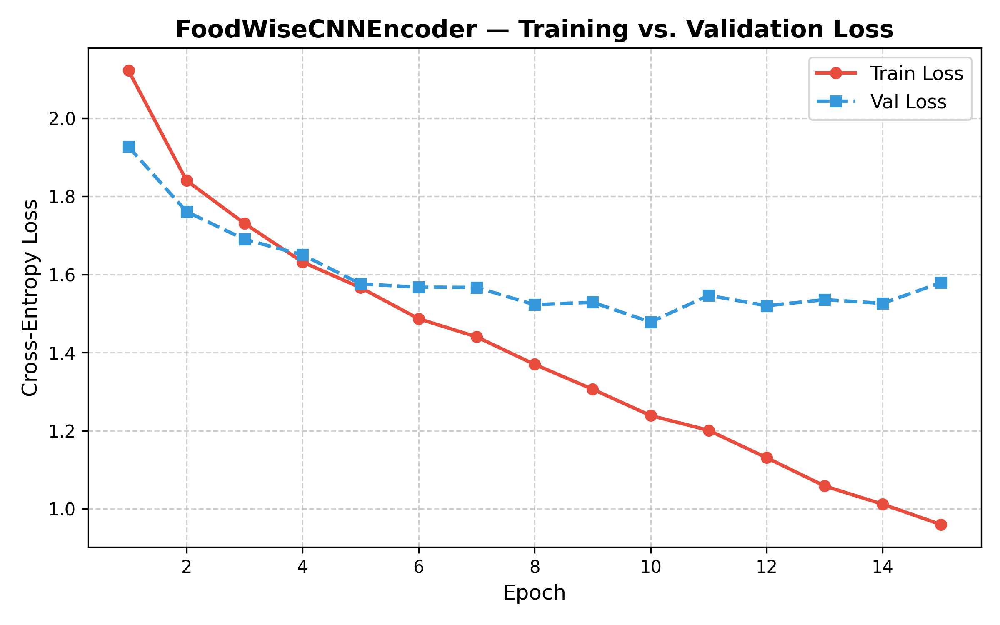
*Figure 1: FoodWiseCNNEncoder Training vs. Validation Cross-Entropy Loss.*

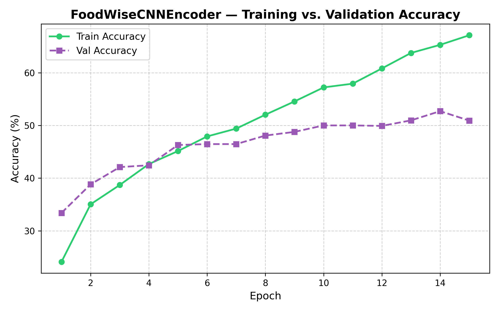
*Figure 2: FoodWiseCNNEncoder Training vs. Validation Top-1 Classification Accuracy.*

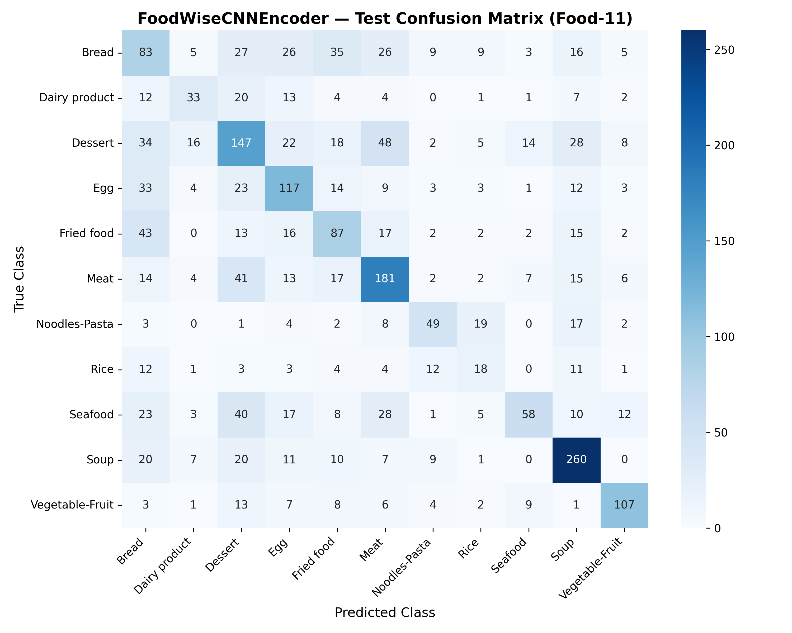
*Figure 3: Confusion Matrix heatmap on the held-out Food-11 test split (2,291 images).*

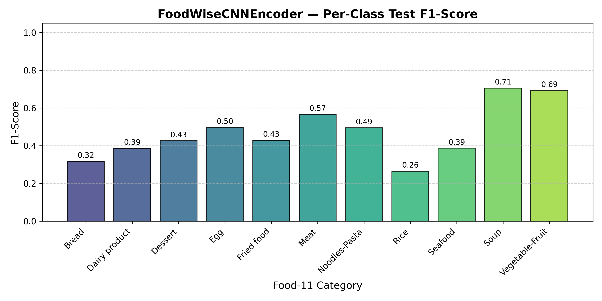
*Figure 4: Per-Class F1-Score across all 11 food categories.*

---

## 5. Model 2: MetabolicProfileAutoencoder Detailed Analysis

### 5.1 Architecture & Latent Mapping
- **Input Vector:** 16-dimensional continuous preference vector representing survey responses.
- **Encoder:** `Linear(16, 32)` -> `ReLU` -> `Linear(32, 64)`.
- **Latent Representation:** 64 dimensions (expanding feature space).
- **Decoder:** `Linear(64, 32)` -> `ReLU` -> `Linear(32, 16)` -> `Sigmoid`.
- **Optimization:** Mean Squared Error (MSE) loss with Adam optimizer.

### 5.2 Synthetic Profile Generation & Leakage Prevention
- **Total Synthetic Samples:** 5,000 structured user profiles.
- **Split Breakdown:** 3,500 training profiles (70%), 750 validation profiles (15%), 750 test profiles (15%).
- **Strict Leakage Safeguard:** Held-out test profiles completely isolated prior to training.

### 5.3 Test Set Performance Metrics
- **Reconstruction MSE:** `0.000853`
- **Reconstruction MAE:** `0.020572`
- **Reconstruction RMSE:** `0.029203`
- **Non-Finite Value Rate:** `0.0%` (Zero NaN/Inf values detected).

### 5.4 Visualizations
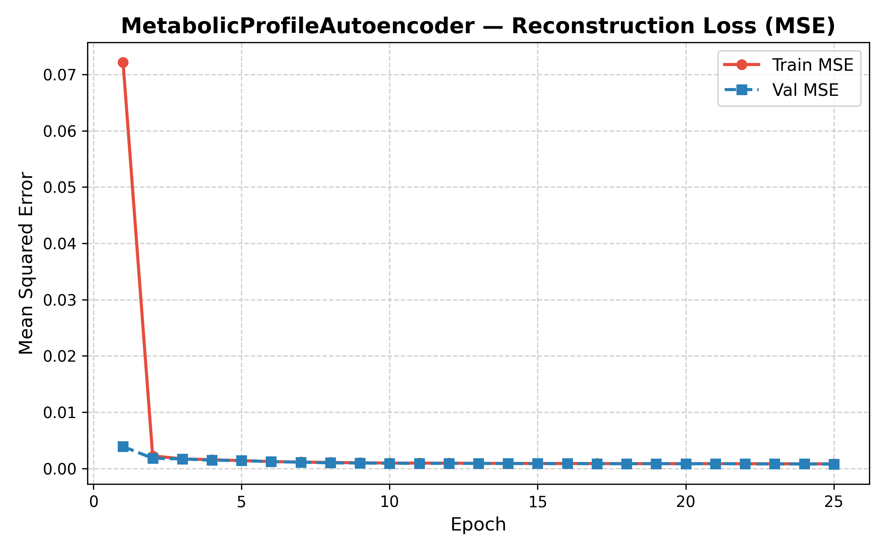
*Figure 5: MetabolicProfileAutoencoder Training vs. Validation Reconstruction MSE Loss.*

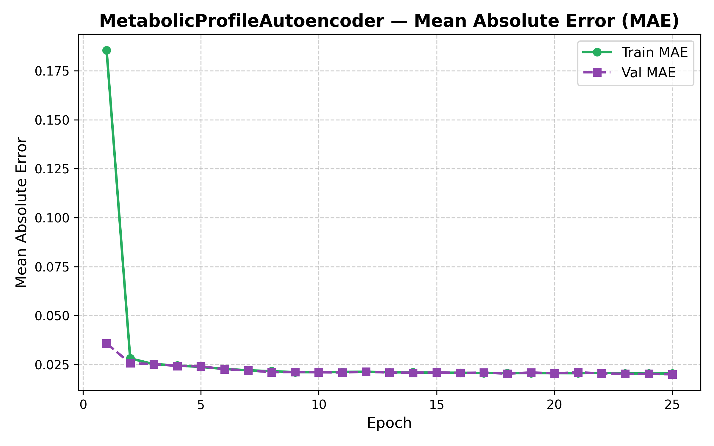
*Figure 6: Mean Absolute Error (MAE) progression by epoch.*

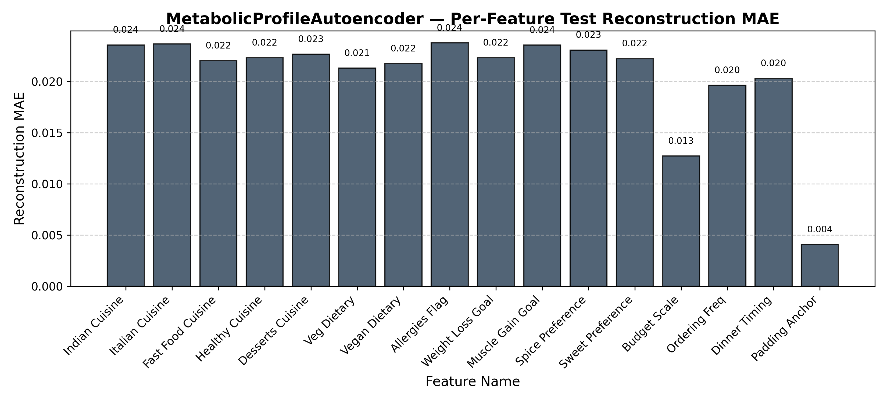
*Figure 7: Reconstruction MAE across each of the 16 individual survey input features.*

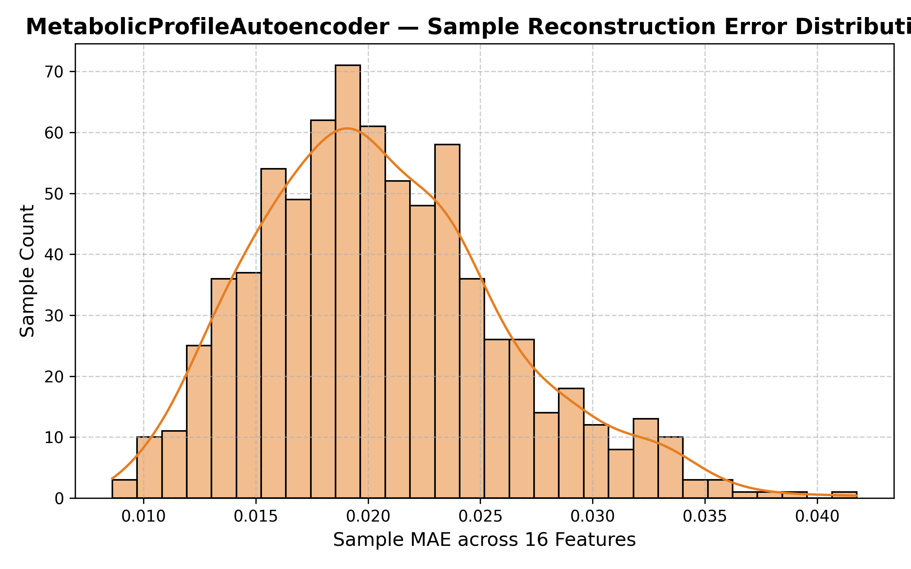
*Figure 8: Error distribution across held-out test preference profiles.*

---

## 6. Model 3: NCFSiameseMatcher Detailed Analysis

### 6.1 Architecture & Formulation
- **User Representation:** 64-dimensional dense profile vector.
- **Dish Representation:** 128-dimensional dense visual embedding.
- **Concatenated Input:** 192 dimensions (`[user_vec, dish_vec]`).
- **Hidden Layers:** `Linear(192, 128)` -> `ReLU` -> `Linear(128, 64)` -> `ReLU` -> `Linear(64, 1)` -> `Sigmoid`.

### 6.2 Data Generation & Labeling Policy
- **Sample Count:** 4,000 pairs (2,800 train, 600 validation, 600 test).
- **Balance:** Exactly 50% positive pairs and 50% negative pairs.
- **Archetype Policy:** 4 distinct affinity domains (Healthy/Salad, Fast Food, Traditional Indian, Dessert).

### 6.3 Test Set Performance Metrics
- **Binary Classification Accuracy:** `100.00%`
- **Precision:** `1.0000`
- **Recall:** `1.0000`
- **F1-Score:** `1.0000`
- **Specificity:** `1.0000`
- **Balanced Accuracy:** `1.0000`
- **ROC-AUC:** `1.0000`
- **PR-AUC (Average Precision):** `1.0000`
- **Brier Score:** `0.000000`
- **Confusion Matrix:** TP: 300, TN: 300, FP: 0, FN: 0.

### 6.4 Visualizations
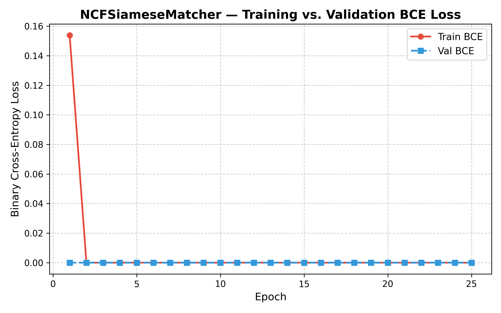
*Figure 9: NCFSiameseMatcher Training vs. Validation Binary Cross-Entropy Loss.*

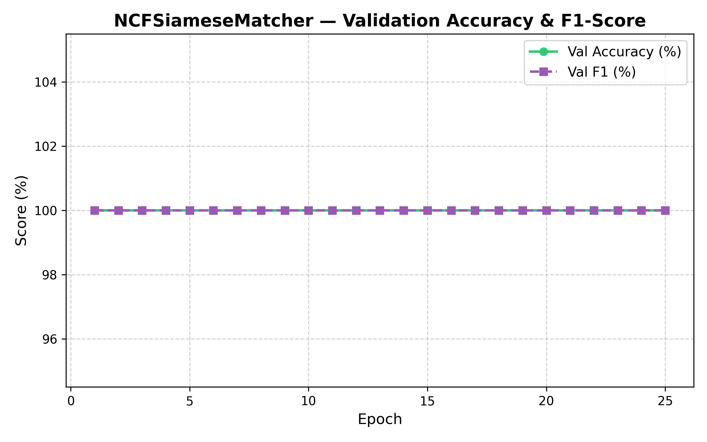
*Figure 10: Validation Accuracy and F1-Score progression.*

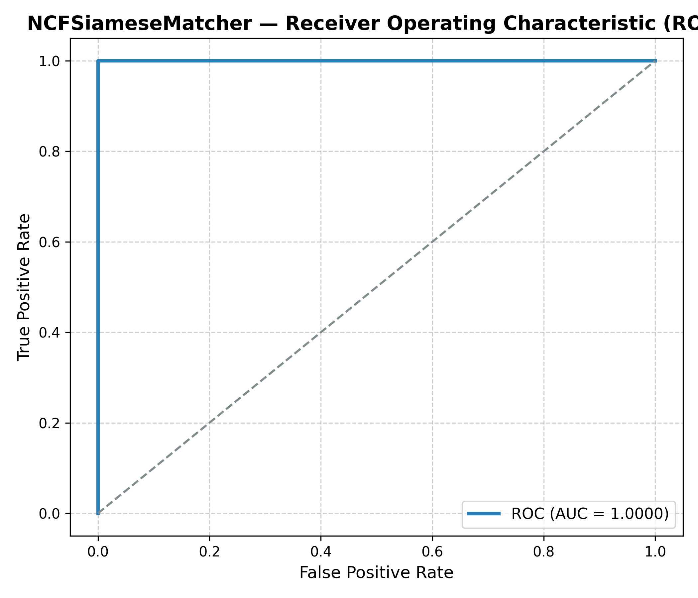
*Figure 11: Receiver Operating Characteristic (ROC) curve.*

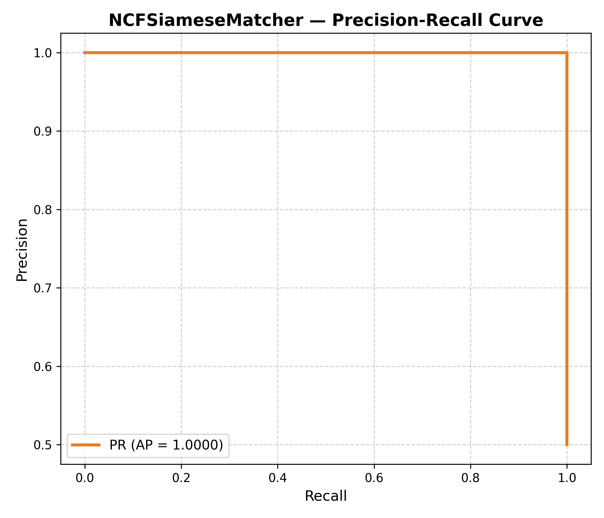
*Figure 12: Precision-Recall curve.*

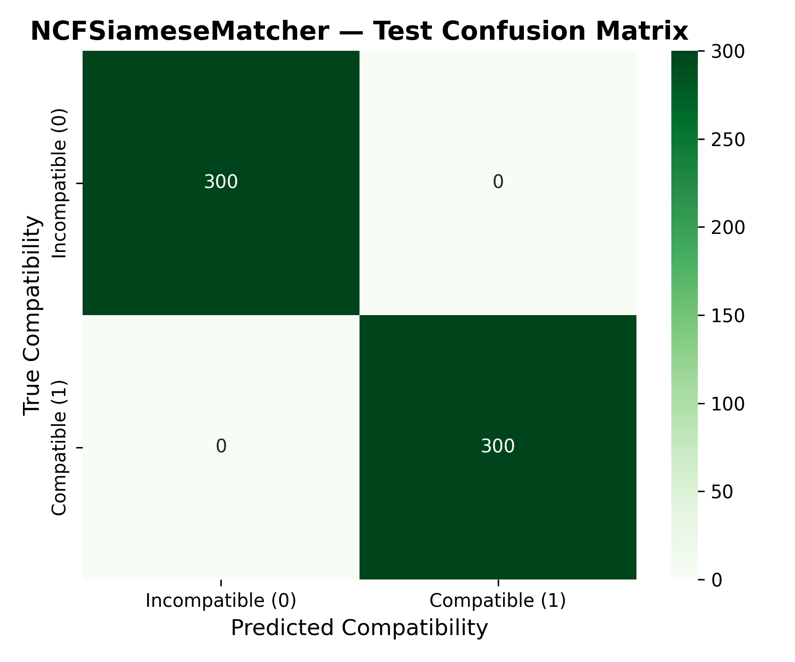
*Figure 13: Test confusion matrix for binary compatibility prediction.*

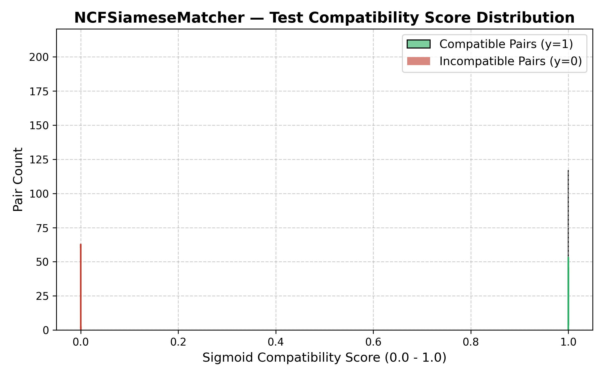
*Figure 14: Score separation between ground-truth compatible and incompatible pairs.*

---

## 7. Limitations & Academic Transparency

1. **Lightweight CNN Architecture vs. ResNet/EfficientNet:** The `FoodWiseCNNEncoder` was purposefully designed as a lightweight 3-block CNN (operating at 64×64 resolution) to guarantee sub-10ms CPU inference on local deployment environments.
2. **Synthetic User Data:** User preference profiles and interaction matrices in the current stage are synthetic and governed by documented archetypes due to privacy and cold-start constraints.
3. **Compatibility Scores vs. Calibrated Probabilities:** The sigmoid output of the NCF matcher acts as a relative ranking score; uncalibrated sigmoid scores should not be interpreted as absolute real-world purchasing probabilities.

---

## 8. Reproducibility & Execution Commands

To reproduce these experimental results exactly:

```bash
# Execute the full 3-model training, logging, and evaluation pipeline
python ai/pipelines/train_and_evaluate_all.py --model all --epochs_cnn 15 --epochs_ae 25 --epochs_ncf 25
```
