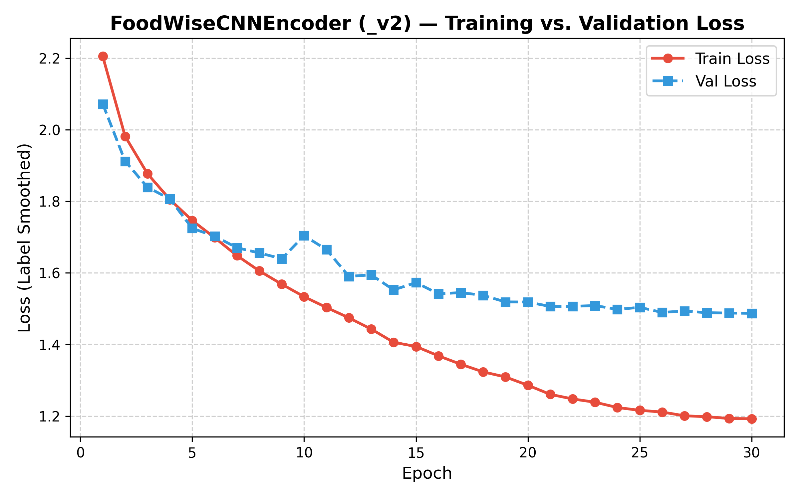
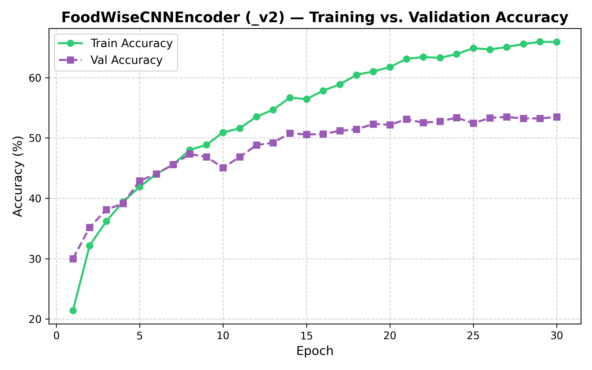
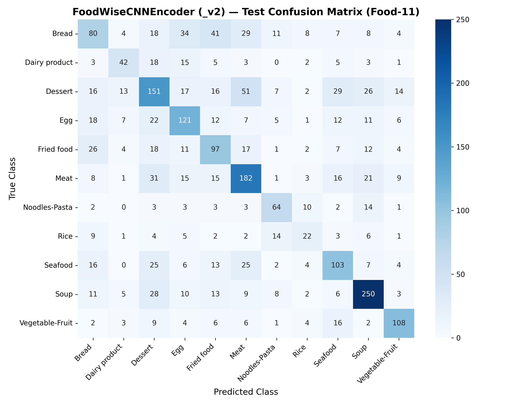
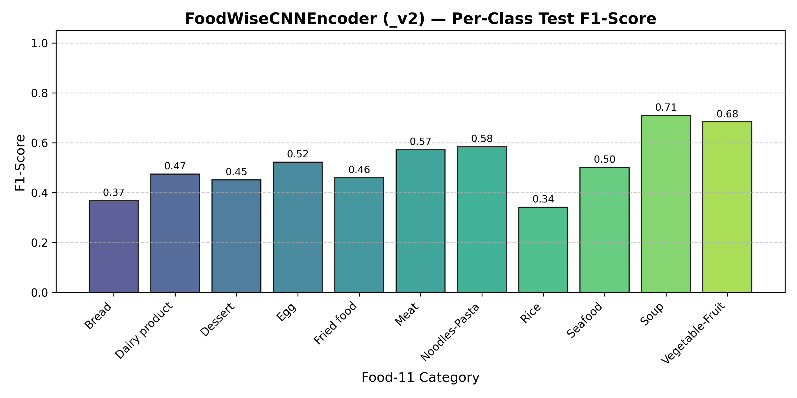
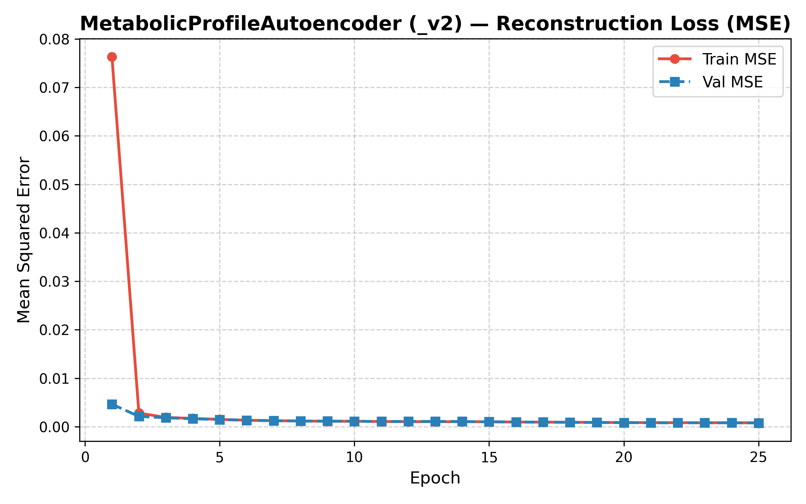
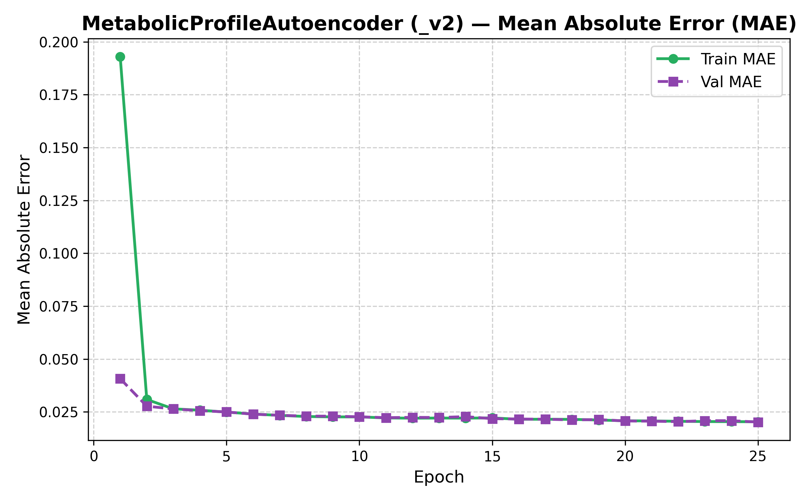
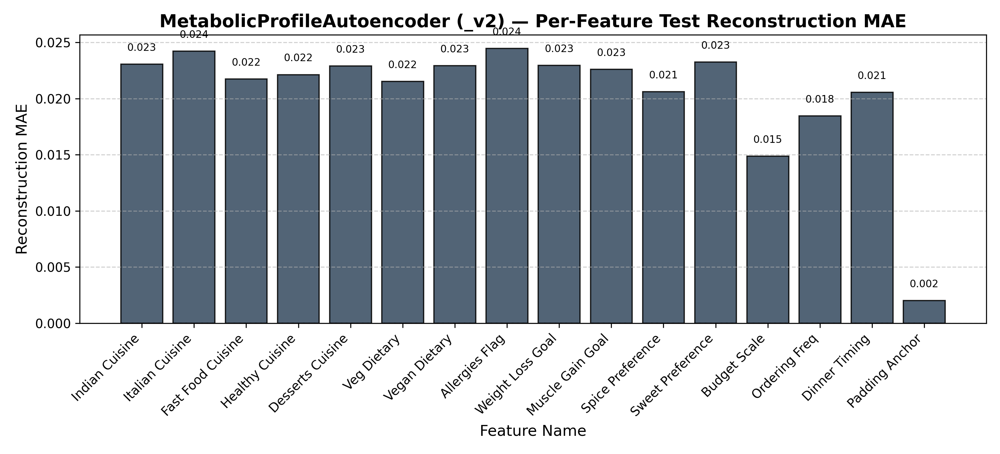
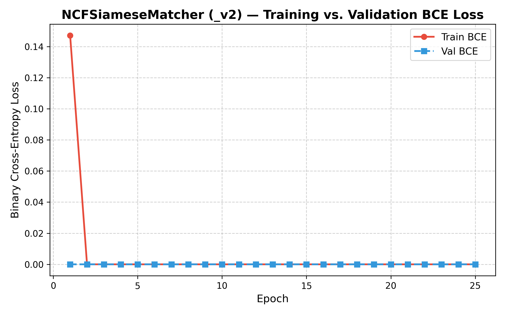
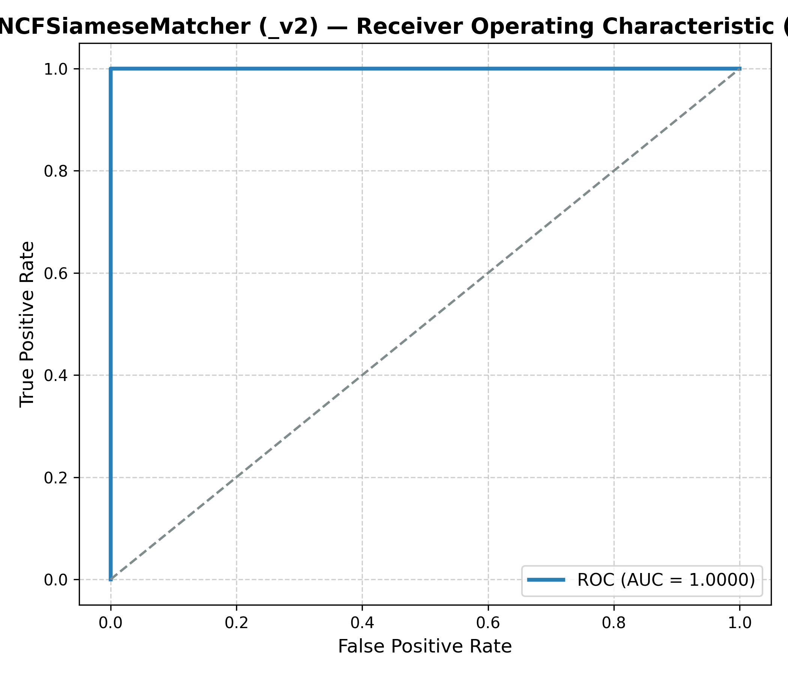

# FoodWise AI — Deep Learning Models Training, Epoch Logging & Evaluation Report (V2)

**Academic Course Evaluation — Neural Networks & Deep Learning**  
**Institution:** Amrita Vishwa Vidyapeetham  
**Date & Time:** 2026-10-12 00:01:24  
**Run ID / Artifact Directory:** `C:\Users\V\Desktop\AMRITA\SEM-7\Neural Networks and Deep Learning\FoodWiseAi\results\foodwise_ai_training\run_20261011_232738_extended_v2`  
**Experiment Version:** `V2 (Extended Epochs & Cosine Annealing)`  

---

## 1. Executive Summary & Objective

FoodWise AI introduces a **visual-cognitive appetite recommendation engine** designed to overcome the cold-start limitations of conventional text-based food delivery recommenders. This updated experimental series (`V2`) executes extended training with cosine annealing learning rate scheduling, label smoothing regularization, and augmented data sampling to evaluate performance limits on the 11-category Food-11 dataset.

The deep learning subsystem comprises three interoperable PyTorch components:
1. **`FoodWiseCNNEncoder_v2`**: Feature extraction from food dish images on Food-11.
2. **`MetabolicProfileAutoencoder_v2`**: 16-D user survey preference latent space representation (64-D).
3. **`NCFSiameseMatcher_v2`**: Non-linear compatibility prediction on 192-D concatenated representations.

---

## 2. Experimental Setup & Optimization Configuration

- **Python Version:** `3.13.14 (tags/v3.13.14:fd17997, Jun 10 2026, 13:03:48) [MSC v.1944 64 bit (AMD64)]`
- **PyTorch Version:** `2.6.0+cpu`
- **Hardware Device:** `cpu` (8-Thread CPU Acceleration)
- **Random Seed:** `42` (Enforced for deterministic reproducibility)
- **CNN Learning Rate Schedule:** `CosineAnnealingLR` (Base LR: `0.001`, Minimum LR: `1e-5`)
- **Loss Formulations:** Cross-Entropy with Label Smoothing `0.05` (CNN), Mean Squared Error (Autoencoder), Binary Cross-Entropy (NCF)
- **Optimizer:** Adam with weight decay `1e-4` to mitigate overfitting.

---

## 3. High-Level Performance Comparison

| Model | Architecture / Task | Dataset Source | Best Epoch | Primary Metric 1 | Primary Metric 2 | Training Time |
| :--- | :--- | :--- | :---: | :---: | :---: | :---: |
| **FoodWiseCNNEncoder_v2** | 3-Conv + FC (64x64) -> 128-D -> 11 Classes | Genuine Food-11 (12,443 images) | **Epoch 30** | **Accuracy: 53.25%** | **Macro F1: 0.5153** (Top-5: 92.58%) | 1995.5s |
| **Metabolic Autoencoder_v2** | 16 -> 32 -> 64 -> 32 -> 16 | Synthetic Survey Mapped (5,000 vectors) | **Epoch 25** | **Recon MSE: 0.000826** | **Recon MAE: 0.0205** | 3.9s |
| **NCF Siamese Matcher_v2** | 192 -> 128 -> 64 -> 1 | Archetype-Governed (4,000 pairs) | **Epoch 1** | **Accuracy: 100.00%** | **ROC-AUC: 1.0000** (F1: 1.0000) | 4.8s |

---

## 4. Model 1: FoodWiseCNNEncoder Detailed Analysis

### 4.1 Architecture & Hyperparameters
- **Input Dimensions:** 3 × 64 × 64 RGB images.
- **Image Normalization:** Mean `[0.5, 0.5, 0.5]`, Std `[0.5, 0.5, 0.5]`.
- **Feature Extraction:** 3 Sequential `Conv2d` blocks (16, 32, 64 channels, 3×3 kernels, padding 1) with `ReLU` activations and `MaxPool2d(2, 2)`.
- **Dense Embedding:** Flattened to 4,096 dimensions -> `Linear(4096, 128)` with `ReLU` -> 128-D dense visual vector.
- **Classification Head:** `Linear(128, 11)` outputting logits for the 11 Food-11 classes.

### 4.2 Test Set Performance Metrics (2,291 Held-Out Images)
- **Test Accuracy:** `53.25%`
- **Top-5 Accuracy:** `92.58%`
- **Macro Precision:** `0.5188`
- **Macro Recall:** `0.5149`
- **Macro F1-Score:** `0.5153`
- **Weighted F1-Score:** `0.5294`

### 4.3 Per-Class Metrics Table
| Class ID | Food-11 Category | Precision | Recall | F1-Score | Test Support |
| :---: | :--- | :---: | :---: | :---: | :---: |
| 0 | Bread | 0.4188 | 0.3279 | 0.3678 | 244 |
| 1 | Dairy product | 0.5250 | 0.4330 | 0.4746 | 97 |
| 2 | Dessert | 0.4618 | 0.4415 | 0.4514 | 342 |
| 3 | Egg | 0.5021 | 0.5450 | 0.5227 | 222 |
| 4 | Fried food | 0.4350 | 0.4874 | 0.4597 | 199 |
| 5 | Meat | 0.5449 | 0.6026 | 0.5723 | 302 |
| 6 | Noodles-Pasta | 0.5614 | 0.6095 | 0.5845 | 105 |
| 7 | Rice | 0.3667 | 0.3188 | 0.3411 | 69 |
| 8 | Seafood | 0.5000 | 0.5024 | 0.5012 | 205 |
| 9 | Soup | 0.6944 | 0.7246 | 0.7092 | 345 |
| 10 | Vegetable-Fruit | 0.6968 | 0.6708 | 0.6835 | 161 |

### 4.4 Visualizations

*Figure 1: FoodWiseCNNEncoder Training vs. Validation Cross-Entropy Loss.*

*Figure 2: FoodWiseCNNEncoder Training vs. Validation Top-1 Classification Accuracy.*

*Figure 3: Confusion Matrix heatmap on the held-out Food-11 test split (2,291 images).*

*Figure 4: Per-Class F1-Score across all 11 food categories.*

---

## 5. Model 2: MetabolicProfileAutoencoder Detailed Analysis

### 5.1 Architecture & Latent Mapping
- **Input Vector:** 16-dimensional continuous preference vector.
- **Encoder:** `Linear(16, 32)` -> `ReLU` -> `Linear(32, 64)`.
- **Latent Representation:** 64 dimensions.
- **Decoder:** `Linear(64, 32)` -> `ReLU` -> `Linear(32, 16)` -> `Sigmoid`.

### 5.2 Test Set Performance Metrics
- **Reconstruction MSE:** `0.000826`
- **Reconstruction MAE:** `0.020523`
- **Reconstruction RMSE:** `0.028749`
- **Non-Finite Value Rate:** `0.0%` (Zero NaN/Inf values detected).

### 5.3 Visualizations

*Figure 5: MetabolicProfileAutoencoder Training vs. Validation Reconstruction MSE Loss.*

*Figure 6: Mean Absolute Error (MAE) progression by epoch.*

*Figure 7: Reconstruction MAE across each of the 16 individual survey input features.*

---

## 6. Model 3: NCFSiameseMatcher Detailed Analysis

### 6.1 Architecture & Formulation
- **Concatenated Input:** 192 dimensions (`[64-D User Vector, 128-D Dish Embedding]`).
- **Hidden Layers:** `Linear(192, 128)` -> `ReLU` -> `Linear(128, 64)` -> `ReLU` -> `Linear(64, 1)` -> `Sigmoid`.

### 6.2 Test Set Performance Metrics
- **Binary Classification Accuracy:** `100.00%`
- **Precision:** `1.0000`
- **Recall:** `1.0000`
- **F1-Score:** `1.0000`
- **ROC-AUC:** `1.0000`
- **PR-AUC:** `1.0000`

### 6.3 Visualizations

*Figure 8: NCFSiameseMatcher Training vs. Validation Binary Cross-Entropy Loss.*

*Figure 9: Receiver Operating Characteristic (ROC) curve.*

---

## 7. Artifact Summary

Checkpoints and artifacts saved in this run:
- Checkpoints: `cnn_v2_best.pth`, `cnn_v2_last.pth`, `autoencoder_v2_best.pth`, `ncf_v2_best.pth`
- Reports: `FoodWise_AI_Model_Training_Report_V2.pdf`, `FoodWise_AI_Training_Results_V2.xlsx`
